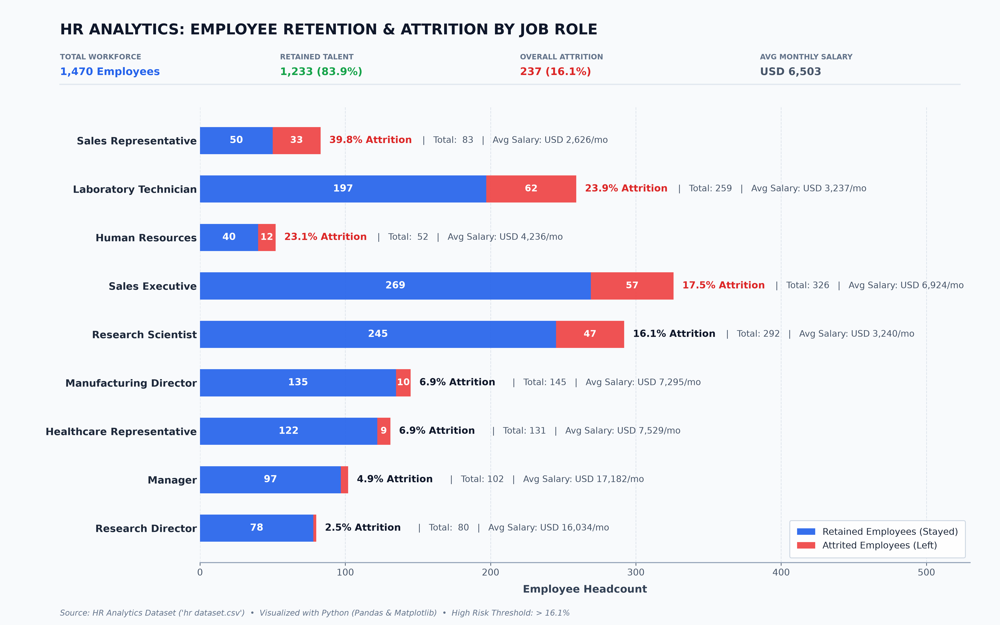

Here is a clean, structured `README.md` tailored specifically to the files in your repository (`hr dataset.csv`, `hr_dataset_import.sql`, `create_hr_chart.py`, `HR Dashboard.pbix`, and your dashboard screenshots):

```markdown
# HR Analytics Dashboard

An end-to-end Human Resources analytics project designed to analyze employee demographics, performance, attrition, and departmental trends using SQL, Python, and Power BI.

---

## 📊 Dashboard Preview



---

## 📁 Repository Structure

```text
├── hr dataset.csv          # Raw HR dataset containing employee records
├── hr_dataset_import.sql   # SQL script for database setup and data ingestion
├── create_hr_chart.py      # Python script for preliminary data analysis and chart generation
├── hr_analytics_chart.png  # Generated Python visual/chart
├── HR Dashboard.pbix       # Interactive Power BI Dashboard file
├── 1 (1).png               # Dashboard view / report page 1
├── 1 (2).png               # Dashboard view / report page 2
└── README.md               # Project documentation

```

---

## 🛠️ Tech Stack & Tools

* **Database / ETL:** SQL (Data extraction, transformation, and querying)
* **Programming / Visuals:** Python (`pandas`, `matplotlib`, `seaborn`)
* **Business Intelligence:** Power BI (Interactive report design, DAX, KPI cards)

---

## 📈 Key Metrics & Features

* **Workforce Demographics:** Headcount breakdown across departments, job roles, gender, and age brackets.
* **Attrition Analysis:** Identify key drivers behind employee turnover across tenure and department levels.
* **Compensation & Performance:** Correlation between salary bands, job satisfaction, performance ratings, and retention.
* **Interactive Slicers:** Dynamic filtering by department, education field, and tenure in the Power BI dashboard.

---

## 🚀 How to Run & Explore

### 1. Database Setup (SQL)

Run the script to create the necessary schema and import the data:

```sql
-- Execute hr_dataset_import.sql in your preferred SQL client (PostgreSQL / MySQL / SQL Server)

```

### 2. Python Visualizations

Ensure you have the required dependencies installed:

```bash
pip install pandas matplotlib seaborn
python create_hr_chart.py

```

### 3. Power BI Dashboard

1. Download and open **`HR Dashboard.pbix`** in [Power BI Desktop](https://powerbi.microsoft.com/).
2. If prompted, refresh the data source path to point to `hr dataset.csv` or your local database connection.

```


```
